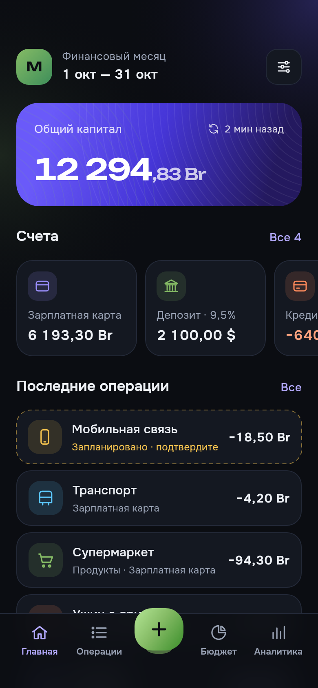
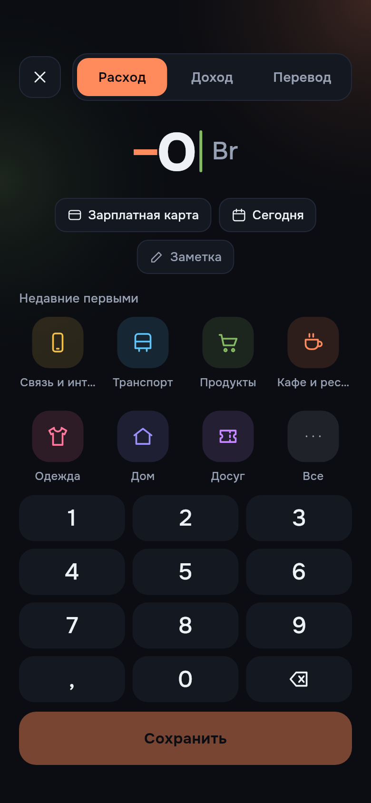
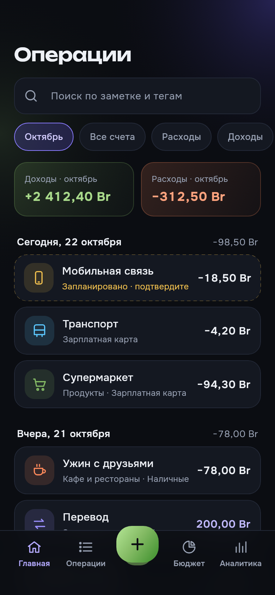
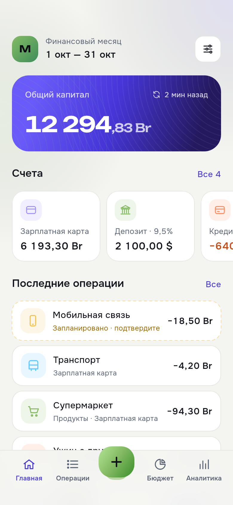

# Smallney

Учёт личных финансов: backend на .NET 10 + PostgreSQL 17 и мобильный клиент на Flutter (offline-first).
Встроенного ИИ нет: категоризация, бюджеты и прогнозы считаются по правилам и формулам.

> Статус: **фаза 5 из 9** — бэкенд готов (auth, курсы НБРБ, счета, операции, регулярные платежи, бюджеты, цели,
> прогноз, аналитика, синхронизация); мобильное приложение: вход и онбординг, локальная БД, синхронизация,
> счета, операции, быстрое добавление.

<p>
  
  
  
  
</p>
> План фаз и принятые решения: [`docs/decisions.md`](docs/decisions.md). Дизайн мобильного приложения: [`design/`](design/DESIGN.md).

## Структура

```
backend/
  src/Finance.Domain          сущности, Money, курсы, чистые правила (без зависимостей)
  src/Finance.Application     фичи (vertical slices): модели, валидаторы, writer'ы, запросы
  src/Finance.Infrastructure  EF Core + Npgsql, миграции, JWT, клиент НБРБ, Hangfire
  src/Finance.Api             Minimal API, ProblemDetails, OpenAPI/Scalar, Serilog
  tests/Finance.Tests.Unit         xUnit
  tests/Finance.Tests.Integration  xUnit + Testcontainers (PostgreSQL 17)
mobile/                       Flutter-клиент (Riverpod, go_router, drift, dio, freezed)
deploy/                       docker-compose для VPS (Caddy + API + PostgreSQL + бэкапы)
design/                       макеты и спецификация UI
docs/decisions.md             решения по неоднозначным местам ТЗ
```

## Быстрый старт (локально)

Нужен Docker. Для разработки без контейнера API — ещё .NET SDK 10.

```bash
docker compose up -d --build        # PostgreSQL на :5445 и API на :5080
curl http://localhost:5080/health    # → Healthy
```

- Scalar UI: http://localhost:5080/scalar (только в Development)
- OpenAPI: http://localhost:5080/openapi/v1.json
- Hangfire Dashboard: http://localhost:5080/hangfire

При первом старте API применяет миграции и загружает курсы НБРБ за сегодня и за 30 предыдущих дней.
Фоновые задачи Hangfire: `exchange-rates` (курсы, каждые 6 часов), `recurring-transactions`
(запланированные платежи из регулярных правил, каждый час) и `sync-log-cleanup` (журнал синхронизации, раз в сутки).

### Основные эндпоинты (`/api/v1`)

| Группа | Что делает |
|---|---|
| `auth/register`, `auth/login`, `auth/refresh`, `auth/logout` | вход, ротация refresh-токена |
| `me` | профиль и настройки (PATCH — JSON Merge Patch) |
| `accounts`, `accounts/summary` | счета с вычисленными балансами, капитал в базовой валюте |
| `categories` | категории, два уровня |
| `transactions`, `transactions/{id}/confirm`, `transactions/{id}/skip` | операции, подтверждение и пропуск запланированных |
| `recurring-rules`, `recurring-rules/occurrences` | регулярные платежи и их вхождения за период |
| `budgets/{yyyy-MM}`, `…/summary`, `…/template`, `…/copy-from-previous` | бюджет месяца, план и факт |
| `savings-goals` | цели с прогрессом и рекомендуемым взносом |
| `forecast` | прогноз балансов до 24 месяцев, тревожные точки, цели к сроку, сценарий «что если» |
| `analytics/categories`, `…/monthly`, `…/compare`, `…/net-worth`, `…/top-expenses`, `…/averages` | аналитика в базовой валюте |
| `rates` | курсы НБРБ |
| `sync/push`, `sync/pull` | синхронизация офлайн-клиента, протокол — [`docs/sync.md`](docs/sync.md) |

Полное описание — в Scalar.

Запуск API из исходников (БД из docker compose):

```bash
docker compose up -d postgres
cd backend
dotnet run --project src/Finance.Api      # http://localhost:5080
```

Если порты заняты: `POSTGRES_PORT=5446 API_PORT=5081 docker compose up -d`.

### Пример

```bash
B=http://localhost:5080/api/v1
TOKEN=$(curl -s -X POST $B/auth/register -H 'Content-Type: application/json' \
  -d '{"email":"me@example.com","password":"password123","firstDayOfMonth":5}' | jq -r .accessToken)

curl -s -X POST $B/accounts -H "Authorization: Bearer $TOKEN" -H 'Content-Type: application/json' \
  -d '{"name":"Карта","type":"DebitCard","currency":"BYN","initialBalance":100000}'

curl -s $B/accounts/summary -H "Authorization: Bearer $TOKEN"
```

Деньги везде передаются целыми числами в минимальных единицах валюты (`100000` = 1000,00 BYN) вместе с кодом ISO 4217.

## Тесты

```bash
cd backend
dotnet test tests/Finance.Tests.Unit
dotnet test tests/Finance.Tests.Integration     # нужен запущенный Docker (Testcontainers)

# покрытие
dotnet test tests/Finance.Tests.Unit --collect:"XPlat Code Coverage"
```

## Миграции

```bash
cd backend
dotnet tool restore
dotnet ef migrations add <Name> -p src/Finance.Infrastructure -s src/Finance.Infrastructure -o Persistence/Migrations
dotnet ef database update -p src/Finance.Infrastructure -s src/Finance.Infrastructure   # обычно не нужно: API мигрирует при старте
```

## Конфигурация

Переменные окружения переопределяют `appsettings.json` (`__` вместо `:`).

| Переменная | По умолчанию | Назначение |
|---|---|---|
| `ConnectionStrings__Postgres` | localhost:5445 | строка подключения к PostgreSQL |
| `Jwt__SigningKey` | — (обязательно, ≥ 32 символов) | ключ подписи JWT (в Development задан) |
| `Jwt__AccessTokenMinutes` | 15 | время жизни access token |
| `Jwt__RefreshTokenDays` | 30 | время жизни refresh token |
| `Database__MigrateOnStartup` | true | применять миграции при старте |
| `Hangfire__Enabled` | true | фоновые задачи (курсы валют) |
| `ExchangeRates__Cron` | `15 */6 * * *` | расписание загрузки курсов (UTC) |
| `ExchangeRates__BackfillDays` | 30 | догрузка пропущенных дней при старте |
| `RateLimiting__AuthPermitPerMinute` | 20 | лимит запросов к `/auth/*` с одного IP |
| `Serilog__MinimumLevel__Default` | Information | уровень логов |

## Деплой на VPS

Нужны Linux-сервер с Docker (Compose v2), домен с A-записью на IP сервера и открытые порты 80 и 443.

```bash
git clone https://github.com/Rudzeniapol/Smallney.git
cd Smallney/deploy
cp .env.example .env
# заполнить DOMAIN, POSTGRES_PASSWORD (openssl rand -hex 24), JWT_SIGNING_KEY (openssl rand -base64 48)
nano .env
mkdir -p backups && sudo chown 999:999 backups
docker compose up -d --build
docker compose logs -f api
```

Caddy сам получит TLS-сертификат. API будет доступен по `https://<DOMAIN>/api/v1`, проверка — `https://<DOMAIN>/health`.
Бэкапы БД каждый день складываются в `deploy/backups`.

Обновление:

```bash
cd Smallney && git pull && cd deploy && docker compose up -d --build
```

Восстановление из бэкапа:

```bash
gunzip -c backups/last/smallney-latest.sql.gz | docker compose exec -T postgres psql -U smallney -d smallney
```

## Мобильное приложение (`mobile/`)

Нужен Flutter 3.47+ (stable). Для Android — Android SDK с принятыми лицензиями (`flutter doctor --android-licenses`).

```bash
cd mobile
flutter pub get
flutter run --dart-define=API_BASE_URL=http://10.0.2.2:5080     # эмулятор Android, бэкенд из docker compose
flutter run --dart-define=API_BASE_URL=https://finance.example.com  # ваш VPS
flutter build apk --release --dart-define=API_BASE_URL=https://finance.example.com
```

Адрес сервера можно поменять и в самом приложении: ссылка «Сервер» внизу экрана входа.
Для запуска на Linux desktop нужен `libsecret-devel` (`sudo dnf install libsecret-devel`).

Сгенерированный код (`*.g.dart`, `*.freezed.dart`, `*.drift.dart`, локализация) закоммичен. После изменения моделей,
таблиц или провайдеров:

```bash
dart run build_runner build
flutter gen-l10n
```

Тесты:

```bash
flutter test                                                   # unit + widget (in-memory drift)
SMALLNEY_E2E_URL=http://localhost:5080 flutter test test/e2e   # клиент против работающего бэкенда
SMALLNEY_SCREENSHOTS=1 flutter test --tags screenshots --update-goldens   # рендер экранов в test/screenshots/png
```

Как устроена синхронизация на клиенте — [`docs/sync.md`](docs/sync.md) и `docs/decisions.md` (D65–D68).

## Клиент из OpenAPI

Будет описано в фазе 9 (генерация Dart-моделей/клиента из `/openapi/v1.json`).
